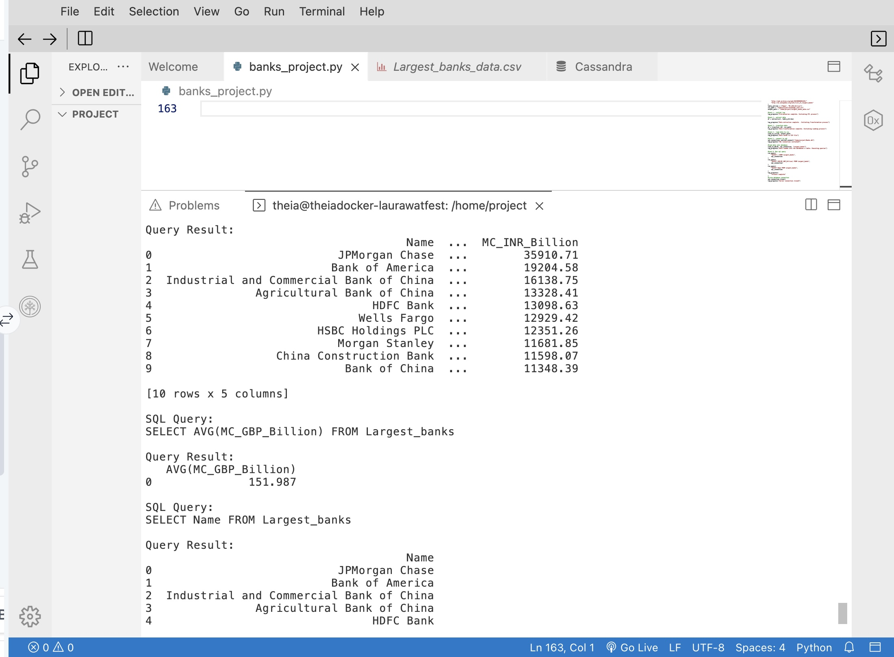
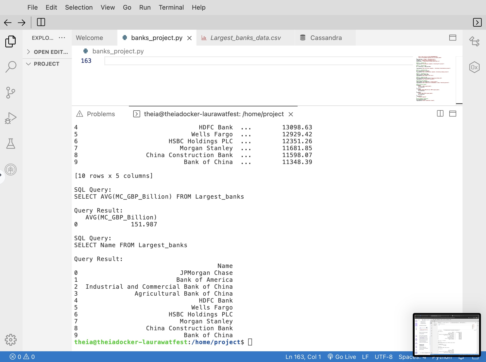

# Global Banks Market Capitalization — Python ETL Pipeline

## Project Overview

This project was developed as part of the **IBM Python Project for Data Engineering** course.

The objective was to build an ETL (Extract, Transform, Load) pipeline using Python to collect, process, and store market capitalization data from the world's largest banks.

## Technologies Used

- Python
- Requests and BeautifulSoup
- Pandas and NumPy
- SQLite and SQL
- CSV
- Python logging with datetime

## ETL Process

**1. Extract**

Extract bank names and market capitalization data in USD from an archived Wikipedia page.

**2. Transform**

Convert market capitalization values from USD into GBP, EUR, and INR using exchange rates provided in a CSV file.

**3. Load**

Save the transformed data to a CSV file and load it into an SQLite database.

**4. SQL Queries**

Execute SQL queries to retrieve the complete dataset, calculate average market capitalization in GBP, and display the first five bank names.

**5. Execution Logging**

Record the main stages of the ETL process in a timestamped log file.

## Project Environment

The project was developed using the IBM Skills Network environment.

The original Python code is preserved as completed during the course. Screenshots document the implementation and execution results.

## Learning Outcomes

This project helped me practice Python-based ETL development, web scraping, data transformation, relational database loading, SQL querying, and execution logging.

## Acknowledgment

Developed as a hands-on learning project during the IBM Data Engineering Professional Certificate program.

## Project Execution Screenshots

The following screenshots document the execution and results of the ETL pipeline developed during the IBM Python Project for Data Engineering course.

